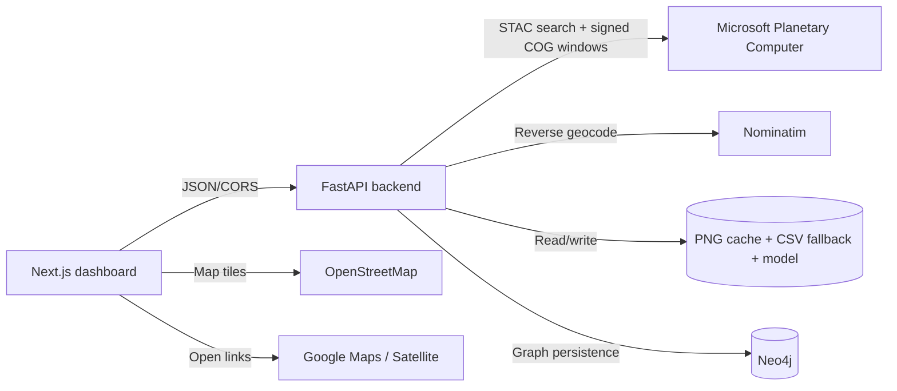

# System Architecture

## Context

GeoSentinel AI has two runtime applications:

- **Frontend:** Next.js sign-in/sign-up preview and dashboard served to a
  browser. Authentication is not connected in this MVP.
- **Backend:** FastAPI service that acquires public imagery, performs analysis,
  persists scans to Neo4j with CSV fallback, and serves media and JSON results.

External services are public or browser-facing:

- Microsoft Planetary Computer STAC and signed preview assets.
- Nominatim reverse geocoding.
- OpenStreetMap tiles in the browser.
- Google Maps links opened from finding reports.



## Repository structure

```text
backend/
  app/main.py              FastAPI routes and image-processing pipeline
  app/satellite_cog.py     Windowed Sentinel-2 COG reads and raster georeferencing
  app/change_model.py      ChangeCNN definition and model loading
  app/history.py           CSV scan/finding fallback persistence
  train_model.py           Dataset loading, labeling, training, metrics
  models/                  change_cnn.pt and metrics.json
  data/                    scans.csv, findings.csv, live cache/media
dataset/
  public-sentinel2-pune/   Real preview pair, manifest, labels.csv
frontend/
  app/page.tsx             Sign-in/sign-up UI preview (no auth backend)
  app/dashboard/page.tsx   Dashboard, scan actions, map, reports
  app/globals.css          Dashboard styling
  app/layout.tsx           Metadata and shell
render.yaml                Render backend service definition
```

## Backend boundaries

### Acquisition

`_live_scenes()` posts a STAC search for the static bounding box, filters
scenes with `eo:cloud_cover < 20`, sorts by acquisition time, and retains the
newest eight. `read_sentinel2_scene()` signs and window-reads each B02, B03,
B04, B08, B11, and SCL COG asset, resampling into one 10 m UTM grid. Assets
with no valid pixels in the requested region are rejected.

### Analysis

`_analyse_pair()` performs the following sequence:

1. Make RGB display previews and align scene pairs with FFT phase correlation.
2. Derive NDVI and Bare Soil Index (BSI) from scaled reflectance bands.
3. Mask SCL no-data, shadow, unclassified, cloud, cirrus, and snow classes.
4. Flag NDVI loss or BSI gain above the configured minimum/90th-percentile
   change threshold.
5. Estimate component coordinates from the UTM raster transform; use the
   existing CNN as an additional score.
6. Connected-component extraction with a minimum component size.
7. Area, confidence, severity, coordinates, bounding box, and map links from
   the georeferenced raster grid.
8. Optional `ChangeCNN` score blended into confidence.

The latest pair supplies the main findings. Adjacent pairs supply timeline
points. At most ten components are returned per pair.

### Persistence

Successful scans are written transactionally to Neo4j. If graph persistence
fails, records are written to the CSV fallback:

- `backend/data/scans.csv`
- `backend/data/findings.csv`

The latest result and two display-preview images are written under
`backend/data/live/`. If the provider rate-limits or another acquisition error
occurs, `last-result.json` is returned with `source.stale: true` when available.

## Frontend boundaries

The dashboard:

- calls `/api/live-detect` on initial load;
- calls it manually from **LIVE SATELLITE SCAN**;
- calls it automatically every ten minutes while the page is open;
- displays live or cached-real-feed status;
- renders the two comparison images;
- renders findings on OpenStreetMap;
- opens Google Maps and Google satellite links;
- downloads a JSON case report in the browser.

The ten-minute interval is an application polling interval. It does not create
new satellite imagery; Sentinel-2 observations are naturally available at an
approximately five-day revisit cadence and cloudy observations can be skipped.

## Deployment topology

Render runs the backend from the `backend` root:

```text
Build:  pip install -r requirements.txt
Start:  uvicorn app.main:app --host 0.0.0.0 --port $PORT
Check:  /api/health
```

The frontend can be deployed separately and must set
`NEXT_PUBLIC_API_URL` to the backend URL. The backend accepts localhost origins
and additional exact origins from `CORS_ORIGINS`.

