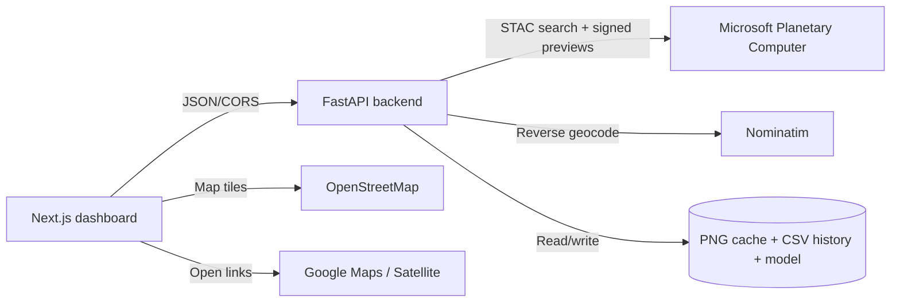

# System Architecture

## Context

GeoSentinel AI has two runtime applications:

- **Frontend:** Next.js dashboard served to a browser.
- **Backend:** FastAPI service that acquires public imagery, performs analysis,
  stores CSV history, and serves media and JSON results.

External services are public or browser-facing:

- Microsoft Planetary Computer STAC and signed preview assets.
- Nominatim reverse geocoding.
- OpenStreetMap tiles in the browser.
- Google Maps links opened from finding reports.



## Repository structure

```text
backend/
  app/main.py              FastAPI routes and image-processing pipeline
  app/change_model.py      ChangeCNN definition and model loading
  app/history.py           CSV scan/finding persistence
  train_model.py           Dataset loading, labeling, training, metrics
  models/                  change_cnn.pt and metrics.json
  data/                    scans.csv, findings.csv, live cache/media
dataset/
  public-sentinel2-pune/   Real preview pair, manifest, labels.csv
frontend/
  app/page.tsx             Dashboard, scan actions, map, reports
  app/globals.css          Dashboard styling
  app/layout.tsx           Metadata and shell
render.yaml                Render backend service definition
```

## Backend boundaries

### Acquisition

`_live_scenes()` posts a STAC search for the static bounding box, filters
scenes with `eo:cloud_cover < 20`, sorts by acquisition time, and retains the
newest eight. `_signed_preview()` signs each `rendered_preview` asset and
downloads it with retry/backoff for HTTP 429 responses.

### Analysis

`_analyse_pair()` performs the following sequence:

1. Per-channel 5th/95th percentile normalization.
2. FFT phase-correlation alignment.
3. Bright, low-colour-spread cloud masking.
4. Mean absolute RGB difference.
5. Threshold at the greater of 25 or the 90th percentile difference.
6. Connected-component extraction with a minimum component size.
7. Area, confidence, severity, coordinates, bounding box, and map links.
8. Optional `ChangeCNN` score blended into confidence.

The latest pair supplies the main findings. Adjacent pairs supply timeline
points. At most ten components are returned per pair.

### Persistence

Successful scans append records to:

- `backend/data/scans.csv`
- `backend/data/findings.csv`

The latest result and two displayed images are written under
`backend/data/live/`. If the provider rate-limits or another acquisition error
occurs, `last-result.json` is returned with `source.stale: true` when available.

## Frontend boundaries

The dashboard:

- calls `/api/live-detect` on initial load;
- calls it manually from **LIVE SATELLITE SCAN**;
- calls it automatically every ten minutes while the page is open;
- displays live or cached-real-feed status;
- renders the two comparison images;
- renders findings on OpenStreetMap;
- opens Google Maps and Google satellite links;
- downloads a JSON case report in the browser.

The ten-minute interval is an application polling interval. It does not create
new satellite imagery; Sentinel-2 observations are naturally available at an
approximately five-day revisit cadence and cloudy observations can be skipped.

## Deployment topology

Render runs the backend from the `backend` root:

```text
Build:  pip install -r requirements.txt
Start:  uvicorn app.main:app --host 0.0.0.0 --port $PORT
Check:  /api/health
```

The frontend can be deployed separately and must set
`NEXT_PUBLIC_API_URL` to the backend URL. The backend accepts localhost origins
and additional exact origins from `CORS_ORIGINS`.

