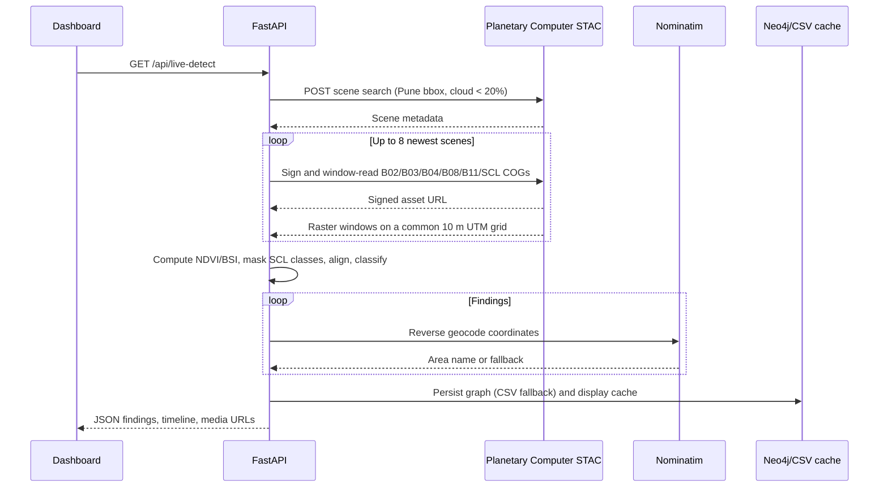
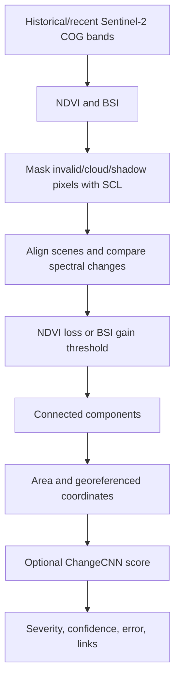

# Working Flow

## 1. User opens the application

1. The browser loads the public overview at `/`. No account or authentication
   is required.
2. The visitor can review the offer at `/pricing`, request a free audit, or
   open the public live demo at `/dashboard`.
3. The pricing form is submitted to Netlify Forms and redirects to
   `/audit-requested`; audit execution and customer onboarding remain manual.
4. The dashboard requests `GET /api/live-detect`.
5. The backend searches the public Sentinel-2 catalog.
6. The dashboard shows the latest pair, findings, timeline, and map.
7. If acquisition is rate-limited but a prior result exists, the page displays
   the cached real result and labels it **CACHED REAL FEED**.

## 2. Live acquisition flow

## 3. Image analysis flow

## 4. Finding review flow

Each finding contains:

- a human-readable area name when reverse geocoding succeeds;
- latitude/longitude;
- estimated changed area in square metres and hectares;
- an estimated error area;
- severity and confidence;
- a region bounding box;
- first and last observed dates;
- Google Maps and satellite URLs;
- a case-file status of `Needs review`.

Selecting a finding updates the case-file panel. Choose a quarry/EIA or
landowner evidence template and optional report brand, then download a
one-page PDF with the selected finding, observation window, cloud status,
before/after imagery when available, and verification cautions.

## 5. Timeline flow

The backend retains up to eight scenes. The oldest retained scene is the
baseline. Each adjacent scene pair is analyzed and contributes one timeline
point. Dates are scene acquisition dates, not fabricated monthly buckets.
Cloud filtering can create gaps longer than five days.

## 6. Upload flow

The dashboard can send two same-size image files to `POST /api/detect`.
Uploads do not use live catalog acquisition, but successful results use the
same Neo4j persistence with CSV fallback. Invalid images, mismatched
dimensions, and images over four megapixels return explicit errors.

## 7. Scheduled scan behavior

The browser refreshes the dashboard every ten minutes while it is open. An
independent Render cron worker checks active custom sites daily and starts a
new scan when the site's latest scan is at least five days old. These cadences
are intentionally separate:

- **Ten minutes:** dashboard refresh/polling.
- **Five days:** minimum interval between scans of the same site.
- **03:00 UTC daily:** worker checks which sites are due.
- **Up to eight scenes:** historical context returned by one live request.

Scheduled scans run even when no browser is open. Manual site scans also reset
the five-day interval. Cached results are not treated as fresh scheduled scans
and never generate alerts.

## 8. Scheduled alert behavior

The worker queues an operator email through Brevo only for a fresh scan with
known cloud-mask coverage below 20% and at least one finding of 1,000 m² or
more with confidence at or above 80%. Delivery state is stored in Neo4j and
failed deliveries are retried. The email explicitly describes the detection
as an automated screening signal, not a legal determination.

## 9. Custom monitoring sites

1. The user imports a KML/GeoJSON polygon or draws a boundary on the map.
2. The dashboard sends the polygon to `POST /api/sites` or uploads the file to
   `POST /api/sites/import`.
3. The backend validates WGS-84 coordinates and stores the site as a
   `MonitoringRegion` in Neo4j.
4. **SCAN SITE** calls `POST /api/sites/{site_id}/scan`.
5. Sentinel-2 search uses the polygon's bounding box; each scene is masked to
   the polygon before spectral analysis, so pixels outside the boundary do not
   contribute to findings.
6. Deleting a site deactivates it while preserving its historical scans.

