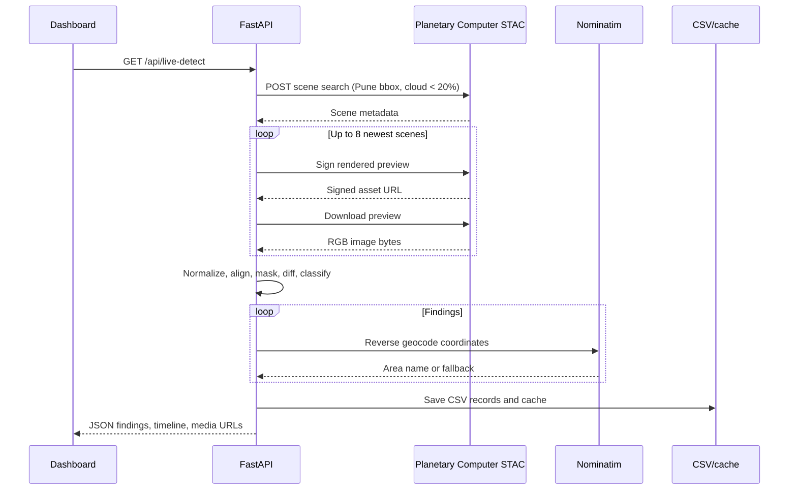
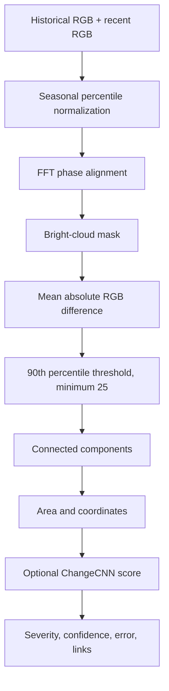

# Working Flow

## 1. User opens the dashboard

1. The browser loads the Next.js page.
2. The page requests `GET /api/live-detect`.
3. The backend searches the public Sentinel-2 catalog.
4. The dashboard shows the latest pair, findings, timeline, and map.
5. If acquisition is rate-limited but a prior result exists, the page displays
   the cached real result and labels it **CACHED REAL FEED**.

## 2. Live acquisition flow

## 3. Image analysis flow

## 4. Finding review flow

Each finding contains:

- a human-readable area name when reverse geocoding succeeds;
- latitude/longitude;
- estimated changed area in square metres and hectares;
- an estimated error area;
- severity and confidence;
- a region bounding box;
- first and last observed dates;
- Google Maps and satellite URLs;
- a case-file status of `Needs review`.

Selecting a finding updates the case-file panel. The report button creates a
downloadable JSON report containing the source, observation window, finding,
and interpretation warning.

## 5. Timeline flow

The backend retains up to eight scenes. The oldest retained scene is the
baseline. Each adjacent scene pair is analyzed and contributes one timeline
point. Dates are scene acquisition dates, not fabricated monthly buckets.
Cloud filtering can create gaps longer than five days.

## 6. Upload flow

The dashboard can send two same-size image files to `POST /api/detect`.
Uploads use the same analysis pipeline but do not use live catalog acquisition
or CSV scan persistence. Invalid images, mismatched dimensions, and images
over four megapixels return explicit errors.

## 7. Scheduled scan behavior

The browser schedules another request every ten minutes while the dashboard is
open. This is intentionally separate from satellite revisit timing:

- **Ten minutes:** dashboard refresh/polling.
- **Approximately five days:** Sentinel-2 revisit opportunity.
- **Up to eight scenes:** historical context returned by one live request.

Keep the dashboard open for automatic polling. A server-side scheduler is not
currently configured.

